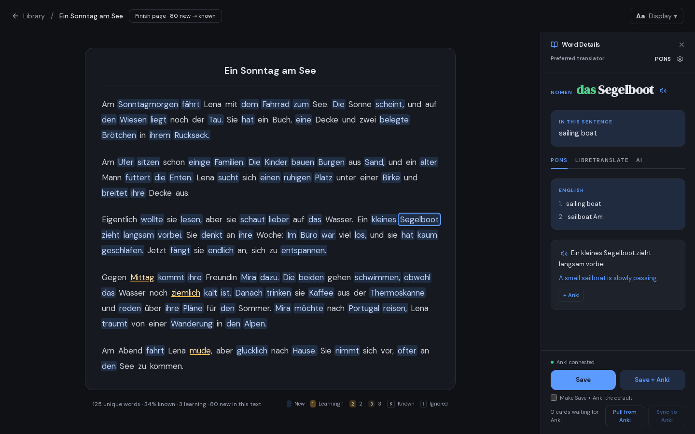
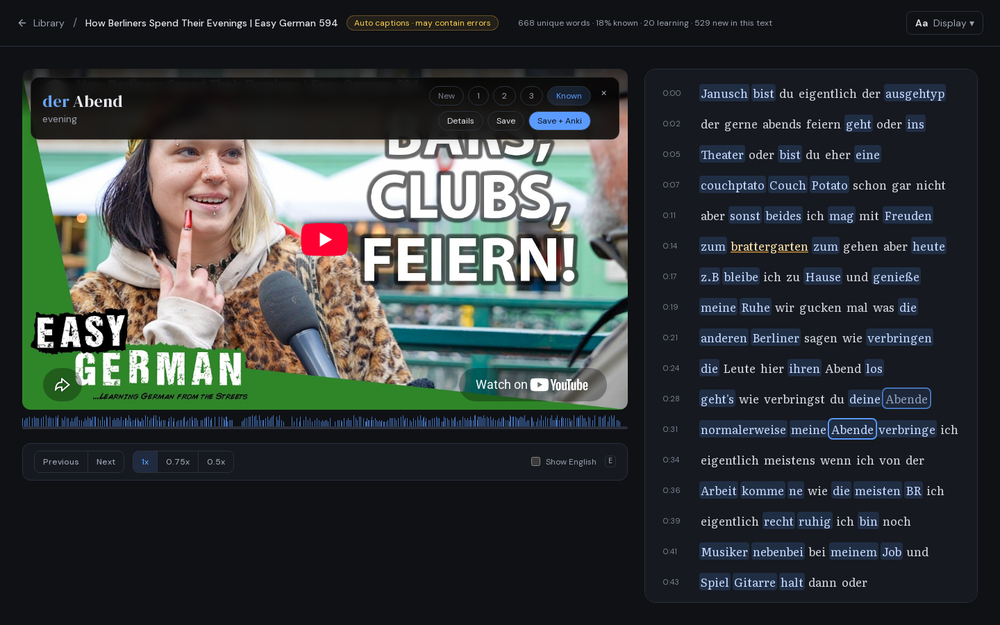
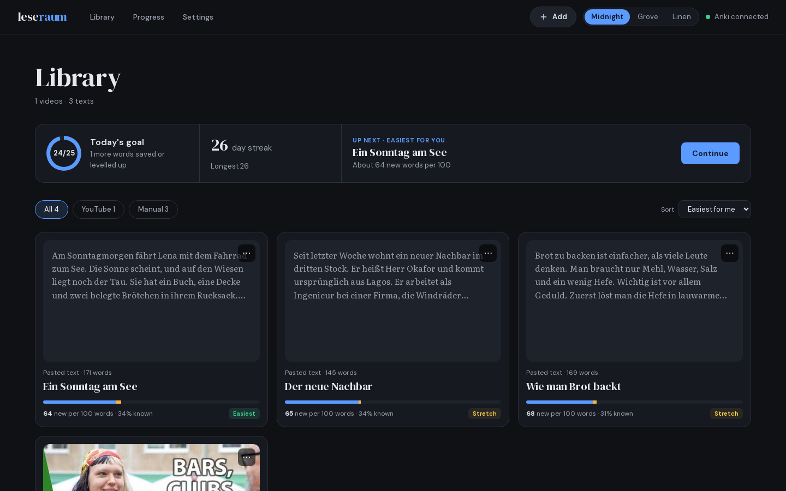
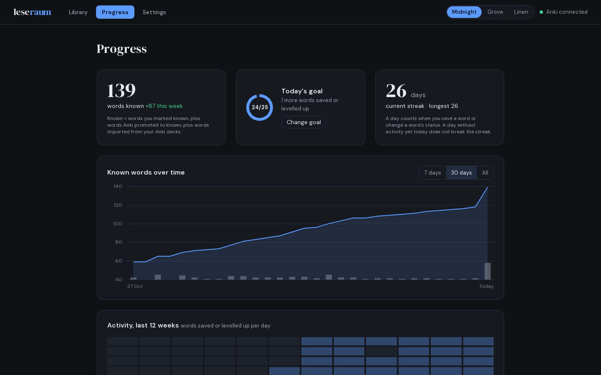
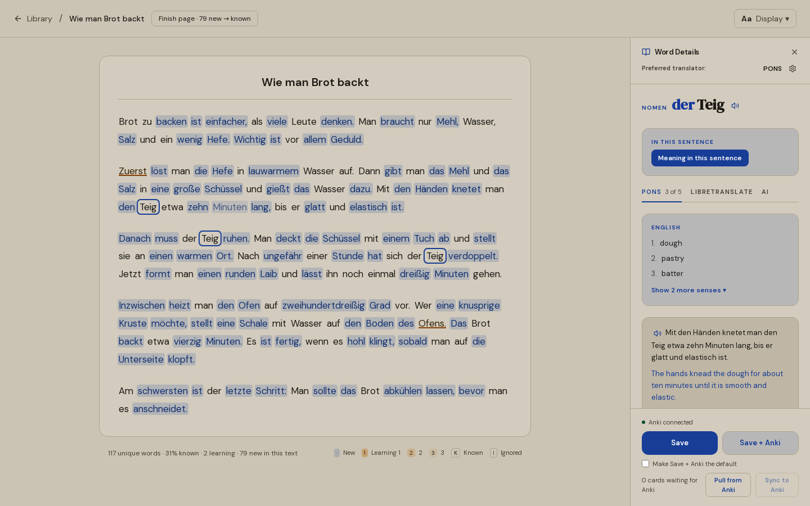
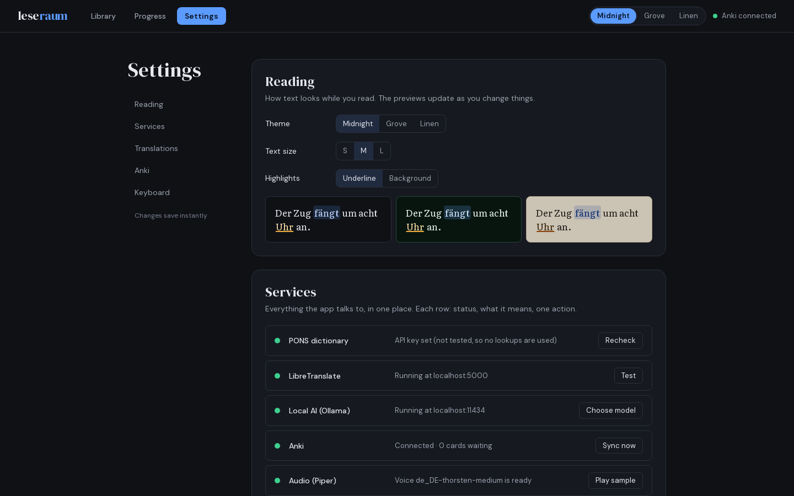

# lang-reader

Read German from YouTube videos and texts, click any word to look it up, and send what you learn to Anki.

Paste a YouTube link or a text, click a word, press `1`, `2`, `3` or `K` to set how well you know it, and press **Save + Anki**. Every word you have seen keeps its colour everywhere you read.

> **Version 1.0.0.** This is a personal, single-user app that runs on your own machine. The core reader needs only Python and Node. Anki, a local AI model, audio and LibreTranslate are optional and are added one at a time. Read [Known issues](#known-issues) before you install it.



<table>
  <tr>
    <td align="center"><br><sub>Video reader</sub></td>
    <td align="center"><br><sub>Library</sub></td>
  </tr>
  <tr>
    <td align="center"><br><sub>Progress</sub></td>
    <td align="center"><br><sub>Linen theme</sub></td>
  </tr>
  <tr>
    <td align="center" colspan="2"><br><sub>Settings and service status</sub></td>
  </tr>
</table>

<sub>Screenshots use demo data: three short texts written for this README and an [Easy German](https://www.youtube.com/@EasyGerman) video.</sub>

## Why this exists

Reading real German is the fastest way to learn it, but every unknown word means switching to a dictionary, a translator and a flashcard app. lang-reader puts those three in one window, next to the text.

- **Local first.** Your words, texts and progress live in one SQLite file on your machine. There is no account and no cloud service of its own.
- **Your Anki stays yours.** Cards go to your own Anki through AnkiConnect, and AnkiWeb sync carries them to your phone. Your existing decks are only read, never changed.
- **Dictionary first, AI second.** PONS gives real dictionary meanings. A local AI model explains the word in its sentence, and it is told to use the dictionary meanings instead of inventing its own.
- **Works without the extras.** Every optional service fails softly. If Anki is closed, cards wait in an outbox. If Ollama is not running, the dictionary tabs still work.

## What works today

| Feature | How to use it |
|---|---|
| YouTube reader | **Add** → paste a YouTube link. The German subtitles (manual or auto-generated) become clickable text next to the video. Clicking a line jumps the video there. |
| Text reader | **Add** → paste text, a web page URL, or upload a `.pdf` or `.epub`. Long texts are split into pages with **Finish page**. |
| Word lookup | Click a word. The side panel shows the base form (`ging` → `gehen`), `der`/`die`/`das` coloured by gender, and meanings from each translator in its own tab. |
| Phrases and separable verbs | Shift + click to select several words. `fängt … an` is looked up as `anfangen`. |
| Word status | Keys `1` `2` `3` (learning), `K` (known), `I` (ignore). Words are coloured by status in every text. |
| Sentence translation | The sentence around the clicked word is translated in the side panel (needs LibreTranslate). |
| AI tab | A local Ollama model explains the word as it is used in this sentence, with two example sentences. Answers are cached. |
| Audio | A play button for the word and its sentence, spoken by a local German voice (Piper). |
| Anki cards | **Save + Anki** creates a word card (both directions) with audio and the sentence. Example sentences can become sentence cards. |
| Anki outbox | If Anki is closed, cards wait as pending. They are sent when the backend starts or when you press **Sync now**. |
| Two-way Anki | **Pull from Anki** promotes words based on their card intervals (21+ days → known). |
| Import your Anki words | Settings → Anki: choose your decks and the field with the German word. Those words become known. |
| `.apkg` export | Settings → Anki → **Export .apkg**, for people without desktop Anki. Importing it again updates the same cards. |
| Library | Every video and text with its "% known · new words" count, a "Today" strip, rename and delete. |
| Progress | Known words over time, a daily streak and a daily goal. |
| Themes | Midnight, Grove and Linen, switched from the top bar. |
| Services check | Settings → Services shows each service as running or not, with what to do about it. |

**Keys in the reader**

```
1 / 2 / 3       Mark the selected word as learning 1, 2 or 3
K               Mark the selected word as known
I               Ignore the selected word
H               Turn highlights on or off
F               Turn focus mode on or off
E               Show or hide the English line (videos)
← / →           Previous or next page of a long text
Shift + click   Extend the selection to a phrase or a separable verb
```

## Known issues

- **YouTube import reads Firefox cookies.** The yt-dlp fallback calls YouTube with your Firefox cookies (`backend/extractors/yt_dlp.py`) and expects Node at `/usr/bin/node`. Without Firefox or with Node somewhere else, imports that reach the fallback fail. See [YouTube import](#youtube-import).
- **One user.** The user id is fixed to `1`. Do not expose the backend to a network you do not trust: it has no login.
- **Importing the same URL twice at the same moment** gives an error 500 instead of "already imported".
- **No size limit on pasted text.** Web pages are capped at 5 MB and files at 20 MB, but pasted text is not.
- **Base forms are not perfect.** The small spaCy model sometimes mistags verbs, so a few words keep the form you clicked.

## Requirements

| Tool | Version | Needed for |
|---|---|---|
| Linux or macOS | | Developed and tested on Ubuntu 22.04 |
| Python | 3.10 or newer (CI uses 3.13) | Backend |
| Node.js | 20 or newer | Frontend, and yt-dlp's YouTube extraction |
| Firefox | any, logged in to YouTube is optional | YouTube import fallback (see [Known issues](#known-issues)) |
| PONS API key | free | Dictionary meanings. Without it, use LibreTranslate. |

**Debian / Ubuntu**

```bash
sudo apt install python3 python3-venv python3-pip git
# Node 20+: use https://github.com/nvm-sh/nvm or the NodeSource packages; Ubuntu's own nodejs is too old
```

## Quick start

These steps give you the core app: reader, lookups, word status, library and progress.

**1. Get the code**

```bash
git clone https://github.com/mawaissaleem/lang-reader.git
cd lang-reader
```

**2. Backend**

```bash
python3 -m venv .venv
source .venv/bin/activate
pip install -r requirements.txt
python -m spacy download de_core_news_sm
```

**3. Configure**

Create `backend/.env`. Only one translator is needed; PONS is the better one.

```env
PONS_API_KEY=your_key_here
DEFAULT_TRANSLATION_PRIORITY=pons,libretranslate
```

Request a free API key from PONS (search "PONS dictionary API"; the free plan has a monthly lookup limit). All keys are listed under [Configuration](#configuration).

**4. Start the backend**

```bash
cd backend
uvicorn main:app --reload --port 8000
```

The database `backend/subtitles.db` is created and migrated on the first start. Check it at `http://localhost:8000/docs`.

**5. Start the frontend** (second terminal)

```bash
cd frontend
npm install
npm run dev
```

**6. Open** `http://localhost:3000`, press **Add** and paste a YouTube link or some German text.

## Optional services

Each service adds one feature. The app runs without any of them. Settings → Services shows which ones it can reach.

| Service | Adds | Short install | `.env` key | Full guide |
|---|---|---|---|---|
| Anki + AnkiConnect | Flashcards, outbox, two-way sync, import of your words | Install Anki desktop, add-on code `2055492159` | `ANKI_CONNECT_URL` | [docs/anki_setup.md](docs/anki_setup.md) |
| Ollama | AI tab: meaning in this sentence, examples | `curl -fsSL https://ollama.com/install.sh \| sh` then `ollama pull qwen2.5:3b` | `OLLAMA_MODEL`, `OLLAMA_URL` | [docs/ollama_setup.md](docs/ollama_setup.md) |
| Piper + ffmpeg | Audio in the side panel and on Anki cards | `pip install piper-tts`, German voice in `backend/voices/`, `apt install ffmpeg` | `PIPER_VOICE`, `TTS_CACHE_DIR` | [docs/piper_setup.md](docs/piper_setup.md) |
| LibreTranslate | A second translator with no quota, and the sentence translation | `docker compose -f docker-compose.libretranslate.yml up -d` | `LIBRETRANSLATE_URL` | [docs/libretranslate_setup.md](docs/libretranslate_setup.md) |

### YouTube import

The app tries two ways to get German subtitles:

1. `youtube-transcript-api`, only if `backend/cookies.txt` exists (Netscape cookie format, exported from a browser that is logged in to YouTube). It is fast.
2. `yt-dlp`, which reads cookies from your Firefox profile and runs YouTube's player code with Node at `/usr/bin/node`.

If imports fail, check the backend log first. Then check that Firefox is installed and that `which node` prints `/usr/bin/node`. If it does not, link it: `sudo ln -s "$(which node)" /usr/bin/node`.

## Configuration

All backend settings go in `backend/.env`. Every key is optional.

| Key | Default | What it does |
|---|---|---|
| `PONS_API_KEY` | none | PONS dictionary key. Without it, PONS lookups are skipped. |
| `LIBRETRANSLATE_URL` | `http://localhost:5000` | Where LibreTranslate runs |
| `DEFAULT_TRANSLATION_PRIORITY` | `pons,libretranslate` | Translator order until you change it in Settings |
| `ANKI_CONNECT_URL` | `http://localhost:8765` | Where AnkiConnect listens |
| `OLLAMA_URL` | `http://localhost:11434` | Where Ollama runs |
| `OLLAMA_MODEL` | none | Default AI model, used until you pick one in Settings |
| `PIPER_VOICE` | `voices/de_DE-thorsten-medium.onnx` | Voice file, relative to `backend/` or absolute |
| `TTS_CACHE_DIR` | `audio_cache` | Where generated mp3 files are kept, relative to `backend/` |
| `DATABASE_URL` | `sqlite:///backend/subtitles.db` | SQLAlchemy database URL |
| `CORS_ORIGINS` | `http://localhost:3000` | Comma-separated frontend origins allowed to call the backend |

The frontend reads one setting, `NEXT_PUBLIC_API_URL` (default `http://localhost:8000`), from `frontend/.env.local`.

**Use it from another device on your network** (for example a tablet):

```env
# backend/.env
CORS_ORIGINS=http://localhost:3000,http://192.168.1.18:3000
```

```env
# frontend/.env.local
NEXT_PUBLIC_API_URL=http://192.168.1.18:8000
```

Then start the backend with `--host 0.0.0.0`. Only do this on a network you trust.

## Where your data lives

Everything stays on your machine. The app itself calls only the services you configure: PONS (internet), YouTube (internet), and your local Anki, Ollama, Piper and LibreTranslate.

```
backend/subtitles.db          Words, statuses, translations, texts, videos, progress, settings
backend/subtitles/            Downloaded .vtt subtitle files
backend/cleaned_subtitles/    Cleaned subtitle text
backend/audio_cache/          Generated mp3 files (safe to delete; they are recreated)
backend/voices/               Piper voice files
backend/.env                  Your keys and settings
```

To back up, copy `backend/subtitles.db` while the backend is stopped. Schema changes are applied automatically on start by Alembic.

## Architecture


Cloud boxes are on the internet (YouTube, PONS, AnkiWeb). External boxes run on your machine (LibreTranslate, Ollama, Anki desktop). Dashed lines are the Anki outbox and sync: cards wait while Anki is closed. The diagram is drawn with [Archify](https://github.com/tt-a1i/archify) from the code at commit `b9675a3`.

```
backend/
  main.py               App setup, CORS, startup (migrations, spaCy, Anki outbox)
  routers/              One module per area
  translators/          PONS, LibreTranslate, Ollama
  extractors/           youtube-transcript-api and yt-dlp
  anki.py               AnkiConnect client, outbox, two-way sync, .apkg export
  tts.py                Piper → mp3 with a disk cache
  lemmatizer.py         spaCy base forms and articles
  migrations/           Alembic
  tests/                unittest suite
frontend/
  app/                  Pages: library (home), progress, settings
  components/           Reader, side panel, library, settings, progress
  lib/                  API client and hooks
  store/                Zustand store
docs/                   Setup guides for the optional services
```

## Development

**Tests and checks** (the same ones CI runs on every push and pull request)

```bash
# backend
cd backend
../.venv/bin/python -m unittest discover -s tests
ruff format --check .

# frontend
cd frontend
npx tsc --noEmit
npm run lint
npm run format:check
npm run test
npm run build
```

**Database migrations**

```bash
cd backend
alembic upgrade head                                   # apply by hand (also runs on start)
alembic revision --autogenerate -m "describe change"   # after editing models.py
```

Review the generated file in `migrations/versions/` before committing it.

**Compare AI models**

```bash
cd backend
../.venv/bin/python scripts/compare_llms.py            # every installed model
../.venv/bin/python scripts/compare_llms.py qwen2.5:3b llama3.2:3b
```

This writes [docs/llm_comparison.md](docs/llm_comparison.md).

## Licence

MIT. See [LICENSE](LICENSE).

`backend/data/de_lemma_lookup.json.gz` comes from [spacy-lookups-data](https://github.com/explosion/spacy-lookups-data) 1.0.5 (MIT).
